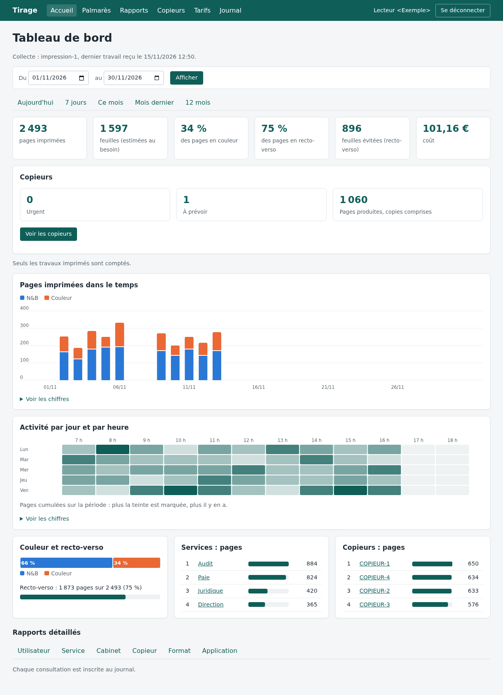
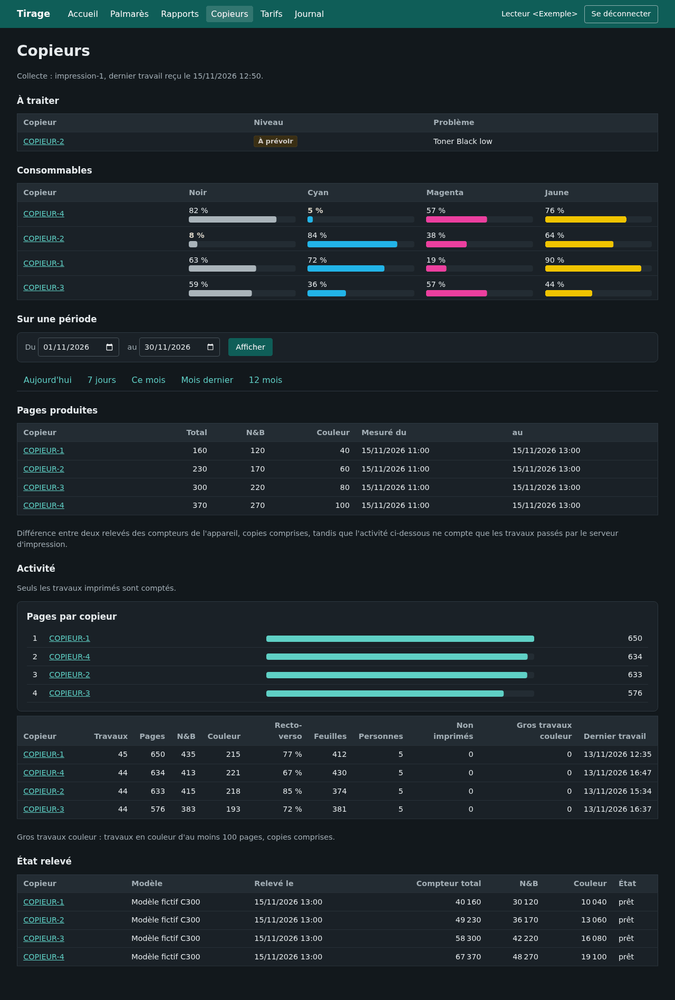
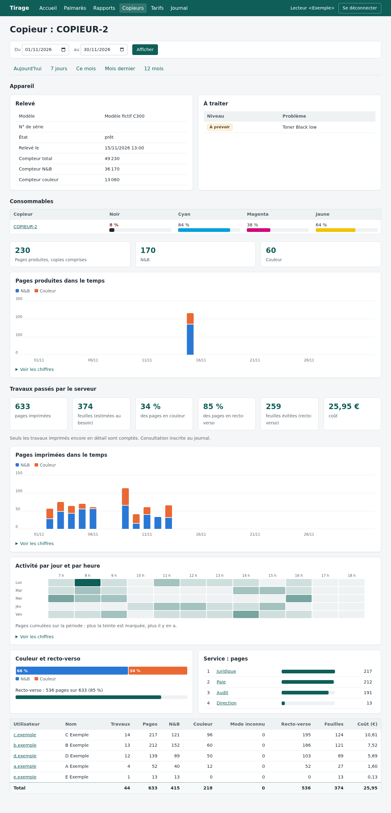

<p align="center">
  
</p>

<h1 align="center">tirage</h1>

<p align="center">
  <b>Suivi des impressions auto-hébergé, pour un serveur d'impression Windows et ses copieurs.</b><br>
  Qui imprime quoi, où, en couleur ou en N&amp;B, pour quel coût, et combien de toner il reste.<br>
  Rien ne sort du réseau : ni nuage, ni télémétrie, ni mise à jour automatique.
</p>

<p align="center">
  <a href="LICENSE"></a>
  
   
</p>

<p align="center"><a href="README.md">English version</a></p>

<p align="center">
  
</p>

> Toutes les captures utilisent des données fictives.

## Fonctions

- **Chaque travail, lu au spouleur** : utilisateur, poste, file, pages, copies, feuilles, couleur ou N&amp;B demandé au
  pilote, recto-verso, format, statut, application. Les travaux attendent sur disque l'accusé de réception du serveur.
- **Copieurs relevés en SNMP** : compteurs N&amp;B et couleur, toners et autres consommables, alertes traduites et
  classées ; pages réellement produites entre deux relevés, copies comprises. Printer-MIB (RFC 3805) et profils de
  marque en fichiers TOML, ajoutés sans recompiler.
- **Tableaux** : par utilisateur, service, cabinet, copieur, format, application ; activité par jour et par heure ;
  comparaison de périodes ; feuilles évitées par le recto-verso ; palmarès ; export CSV.
- **Coûts** : prix par page N&amp;B et couleur, général ou par copieur, saisi dans l'interface.
- **Connexion par l'annuaire** : LDAP ou Active Directory, accès limité à un groupe ; chaque consultation du détail
  d'une personne est inscrite au journal.
- **Protection des données dès la conception** : conservation réglable (titre des documents absent, application seule
  ou complet), purge automatique qui garde des totaux anonymes, guide d'information des personnes.

<table>
  <tr>
    <td></td>
    <td></td>
  </tr>
  <tr>
    <td align="center">Copieurs, mode sombre</td>
    <td align="center">Fiche d'un copieur</td>
  </tr>
</table>

## Fonctionnement

```
 Serveur d'impression Windows                 Serveur Linux (ou Windows)
┌───────────────────────────┐  HTTPS + jeton   ┌──────────────────────────────┐
│ tirage-collecteur         │ ───────────────► │ tirage-serveur               │
│  · notifications spouleur │  événements JSON │  · SQLite                    │
│  · relevés SNMP           │                  │  · pages rendues au serveur, │
│  · file sur disque        │                  │    graphiques SVG, sans JS   │
└───────────────────────────┘                  │  · connexion LDAP            │
        │ SNMP                                 └──────────────────────────────┘
        ▼                                                 ▲ HTTPS (nginx)
     copieurs                                             │ lecteurs
```

Deux binaires autonomes, sans dépendance à l'exécution. Détail : [ADR 0001](docs/architecture/0001-architecture.md).

## Démarrer

```sh
cargo build --release --workspace
cargo test --workspace
```

1. **Serveur** : [docs/guides/serveur.md](docs/guides/serveur.md) (service systemd et exemple nginx dans
   [`deploiement/`](deploiement/), configuration d'après
   [`serveur.exemple.toml`](crates/tirage-serveur/serveur.exemple.toml)). Jeton d'un collecteur :
   `tirage-serveur --nouveau-jeton NOM`.
2. **Annuaire** : [docs/guides/annuaire.md](docs/guides/annuaire.md).
3. **Collecteur** : sur le serveur d'impression, configuration d'après
   [`collecteur.exemple.toml`](crates/tirage-collecteur/collecteur.exemple.toml), puis
   `tirage-collecteur --installer` pour inscrire le service Windows. Essai :
   [docs/guides/essai-collecteur.md](docs/guides/essai-collecteur.md).
4. **Personnes** : les informer avant la collecte, [docs/guides/information-des-personnes.md](docs/guides/information-des-personnes.md).

## Organisation du dépôt

| Chemin | Contenu |
|---|---|
| `crates/tirage-modele` | Format d'échange versionné (travaux, relevés) |
| `crates/tirage-file` | File d'attente sur disque |
| `crates/tirage-snmp` | Client SNMP et profils de marque |
| `crates/tirage-collecteur` | Service Windows : spouleur et SNMP |
| `crates/tirage-serveur` | Réception, stockage, interface web |
| `docs/architecture` | Décisions d'architecture |
| `docs/guides` | Guides d'installation et d'exploitation |

## Documentation

- Décisions : [architecture](docs/architecture/0001-architecture.md) ·
  [données personnelles](docs/architecture/0002-donnees-personnelles.md) ·
  [client SNMP](docs/architecture/0003-client-snmp.md) ·
  [annuaire et connexion](docs/architecture/0004-annuaire-et-connexion.md)
- [Journal des versions](CHANGELOG.md) · [Contribuer](CONTRIBUTING.md) · [Sécurité](SECURITY.md) ·
  [Code de conduite](CODE_OF_CONDUCT.md)

## Contribuer

Tickets et demandes de fusion bienvenus : voir [CONTRIBUTING.md](CONTRIBUTING.md). Une faille se signale en privé,
comme décrit dans [SECURITY.md](SECURITY.md).

## Licence

[AGPL-3.0-only](LICENSE)
