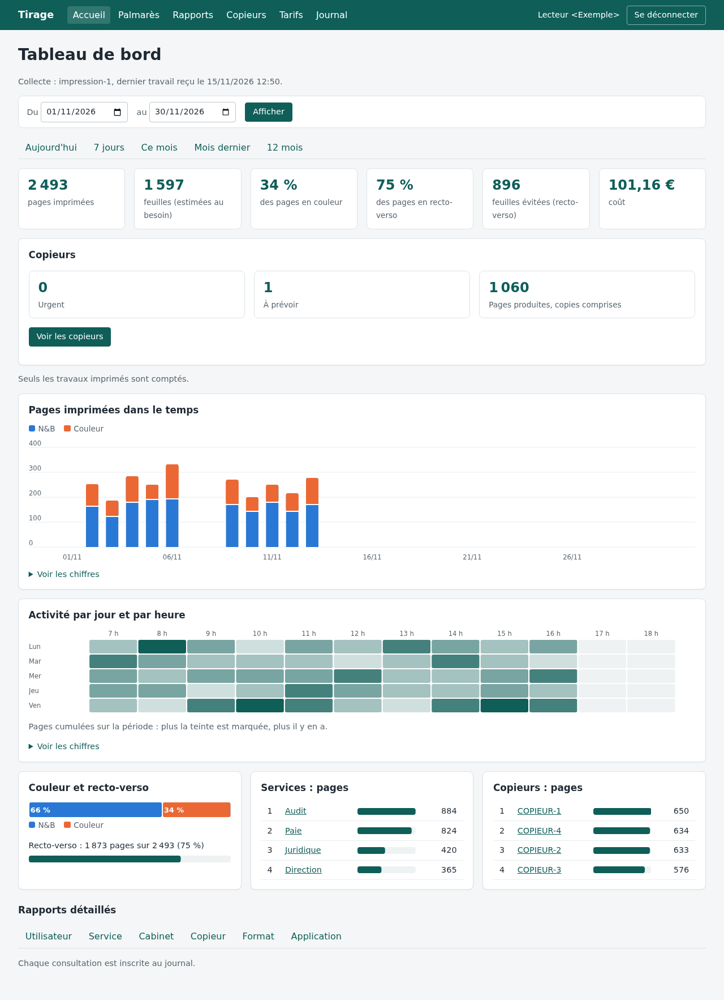
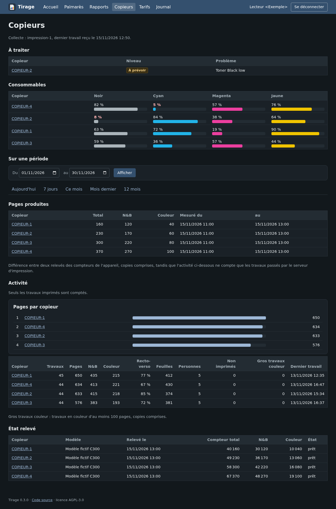
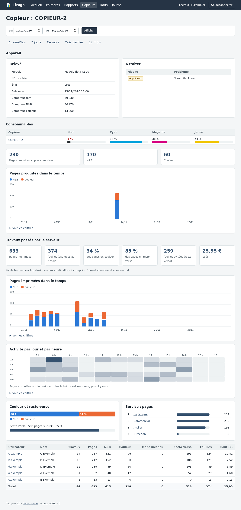

<p align="center">
  
</p>

<h1 align="center">tirage</h1>

<p align="center">
  <b>Self-hosted print tracking for a Windows print server and its copiers.</b><br>
  Who prints what, where, in colour or black &amp; white, at what cost — and how much toner is left.<br>
  Nothing leaves your network: no cloud, no telemetry, no automatic update.
</p>

<p align="center">
  <a href="LICENSE"></a>
  
   
</p>

<p align="center"><a href="README.fr.md">Version française</a></p>

<p align="center">
  
</p>

> The web interface is in French. All screenshots use fictitious data.

## Features

- **Every job, from the spooler** — user, workstation, queue, pages, copies, sheets, colour or B&amp;W as requested
  from the driver, duplex, paper size, status, application. Jobs are queued on disk until the server acknowledges them.
- **Copiers over SNMP** — B&amp;W and colour counters, toner and other consumables, alerts, translated and ranked;
  pages actually produced between two readings, copies included. Printer-MIB (RFC 3805) plus brand profiles as TOML
  files, added without recompiling.
- **Dashboards** — by user, department, site, copier, paper size, application; activity by day and hour; period
  comparison; sheets saved by duplex; top lists; CSV export.
- **Costs** — B&amp;W and colour price per page, global or per copier, entered in the interface.
- **Directory sign-in** — LDAP / Active Directory, access limited to one group; every view of a person's detail is
  written to an audit log.
- **Privacy by design** — configurable retention (document titles off, application only, or full), automatic purge
  that keeps anonymous totals, guide to inform the people concerned.

<table>
  <tr>
    <td></td>
    <td></td>
  </tr>
  <tr>
    <td align="center">Copiers, dark mode</td>
    <td align="center">One copier</td>
  </tr>
</table>

## How it works

```
 Windows print server                         Linux (or Windows) server
┌───────────────────────────┐   HTTPS + token  ┌──────────────────────────────┐
│ tirage-collecteur         │ ───────────────► │ tirage-serveur               │
│  · spooler notifications  │   JSON events    │  · SQLite                    │
│  · SNMP readings          │                  │  · server-rendered pages,    │
│  · on-disk queue          │                  │    SVG charts, no JavaScript │
└───────────────────────────┘                  │  · LDAP sign-in              │
        │ SNMP                                 └──────────────────────────────┘
        ▼                                                 ▲ HTTPS (nginx)
     copiers                                              │ readers
```

Two single binaries, no runtime dependency. Details: [ADR 0001](docs/architecture/0001-architecture.md).

## Getting started

Download the archives from [Releases](https://github.com/lugio/tirage/releases), then:

```sh
# 1. Server (Linux, systemd) — creates everything and prints the collector token once
tar -xzf tirage-serveur-X.Y.Z-linux-x86_64.tar.gz && cd tirage-serveur-X.Y.Z-linux-x86_64
sudo ./installer-serveur.sh
```

```powershell
# 2. Collector — on the Windows print server, administrator PowerShell; paste the token when asked
powershell -ExecutionPolicy Bypass -File .\installer-collecteur.ps1 -Serveur https://tirage.example.org
```

3. **Interface** — add the `[annuaire]` section (LDAP / Active Directory) to `/etc/tirage/serveur.toml` and restart.

Step-by-step guide, HTTPS, copiers, updates and removal: **[docs/guides/installation.md](docs/guides/installation.md)**
(in French). Inform the people concerned before collecting:
[docs/guides/information-des-personnes.md](docs/guides/information-des-personnes.md).

Build from source: `cargo build --release --workspace` (toolchain pinned in `rust-toolchain.toml`).

## Repository layout

| Path | Content |
|---|---|
| `crates/tirage-modele` | Versioned exchange format (jobs, readings) |
| `crates/tirage-file` | On-disk queue |
| `crates/tirage-snmp` | SNMP client and brand profiles |
| `crates/tirage-collecteur` | Windows service: spooler + SNMP |
| `crates/tirage-serveur` | Reception, storage, web interface |
| `docs/architecture` | Architecture decision records |
| `docs/guides` | Installation and operation guides |

## Documentation

- Decisions: [architecture](docs/architecture/0001-architecture.md) ·
  [personal data](docs/architecture/0002-donnees-personnelles.md) ·
  [SNMP client](docs/architecture/0003-client-snmp.md) ·
  [directory and sign-in](docs/architecture/0004-annuaire-et-connexion.md)
- [Changelog](CHANGELOG.md) · [Contributing](CONTRIBUTING.md) · [Security](SECURITY.md) ·
  [Code of conduct](CODE_OF_CONDUCT.md)

## Contributing

Issues and pull requests are welcome — see [CONTRIBUTING.md](CONTRIBUTING.md). Please report vulnerabilities
privately, as described in [SECURITY.md](SECURITY.md).

## License

[AGPL-3.0-only](LICENSE)
